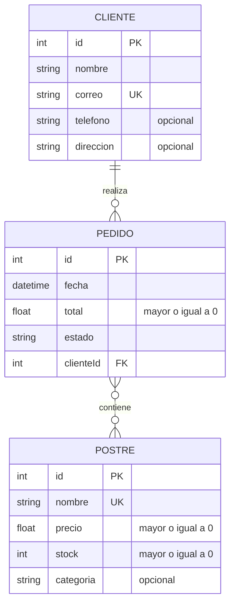

# Modelo ER del emprendimiento · Grupo G06

## Diagrama

## Entidades

| Entidad | Atributos (tipo) | Clave primaria | Únicos / obligatorios / reglas |
|---|---|---|---|
| Postre (principal) | id (int), nombre (string), precio (float), stock (int), categoria (string) | id | `nombre` único y obligatorio (mínimo 3 caracteres); `precio` ≥ 0; `stock` entero ≥ 0, por defecto 0; `categoria` opcional |
| Cliente | id (int), nombre (string), correo (string), telefono (string), direccion (string) | id | `nombre` y `correo` obligatorios; `correo` único; `telefono` y `direccion` opcionales |
| Pedido | id (int), fecha (datetime), total (float), estado (string), clienteId (int) | id | `fecha` por defecto la actual; `total` ≥ 0; `clienteId` es clave foránea hacia Cliente |

## Relaciones

| Entidad A | Cardinalidad (1:1, 1:N, N:M) | Entidad B | Ejemplo en una frase |
|---|---|---|---|
| Cliente | 1:N | Pedido | Un cliente realiza muchos pedidos, y cada pedido pertenece a un solo cliente |
| Pedido | N:M | Postre | Un pedido contiene varios postres, y un postre aparece en muchos pedidos |

## ¿Qué se implementa en cada laboratorio?

- **Lab 2:** la entidad principal (Postre) y una segunda entidad (Cliente) en `schema.prisma`, sin relaciones.
- **Lab 3:** las relaciones (`@relation`) y las entidades restantes (Pedido).
