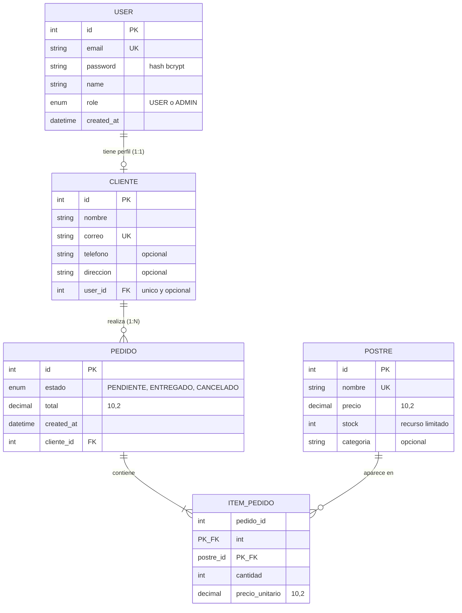

# Modelo ER final · Grupo G06 · Dulce Hogar

> Versión del Lab 3: entidades finales, relaciones con su cardinalidad y el `onDelete` de cada una, justificado.
> Es el modelo que implementa `prisma/schema.prisma`.

## Diagrama

## Relaciones, cardinalidad y `onDelete`

| Relación | Cardinalidad | `onDelete` | Por qué se eligió |
|---|---|---|---|
| User — Cliente | 1:1 (FK única `user_id`, opcional) | **Cascade** | El perfil de cliente no tiene sentido sin su cuenta: al borrar el usuario se borra su perfil. Los clientes del Lab 2 pueden existir sin usuario |
| Cliente — Pedido | 1:N | **Restrict** | Se conserva el historial de ventas: no se puede borrar un cliente que ya tiene pedidos (responde 409) |
| Pedido — ItemPedido | 1:N | **Cascade** | Los ítems no existen sin su pedido: si se borra el pedido, se borran sus líneas |
| Postre — ItemPedido | 1:N | **Restrict** | No se puede borrar un postre que ya se vendió, para no perder el detalle de los pedidos (responde 409) |
| Pedido — Postre | **N:M** (explícita, con `ItemPedido`) | — | Un pedido incluye varios postres y un postre está en muchos pedidos. La tabla intermedia guarda datos propios: `cantidad` y `precio_unitario` |

## Elementos de mapeo

| Elemento | Dónde |
|---|---|
| `enum` | `Role` (USER, ADMIN) y `EstadoPedido` (PENDIENTE, ENTREGADO, CANCELADO) |
| `Decimal` | `precio`, `total` y `precio_unitario`, con `@db.Decimal(10, 2)` (dinero sin errores de redondeo) |
| `DateTime` | `created_at` y `updated_at` |
| Índice compuesto | `@@index([estado, created_at])` en `pedidos`, para filtrar y ordenar el listado del administrador |
| Índice | `@@index([cliente_id])` en `pedidos` |
| Clave compuesta | `@@id([pedidoId, postreId])` en `ItemPedido`: un postre no se repite dentro del mismo pedido |
| Nombres en snake_case | `@map("created_at")`, `@@map("items_pedido")`, etc. |

## Recurso limitado y transacción

El recurso limitado es el **stock** de cada postre. Al crear un pedido, una transacción descuenta el stock con una actualización condicional (`stock >= cantidad`). Si algún postre no alcanza, responde **409** y la base queda sin cambios (**ROLLBACK**). Al cancelar un pedido pendiente, otra transacción devuelve el stock.
