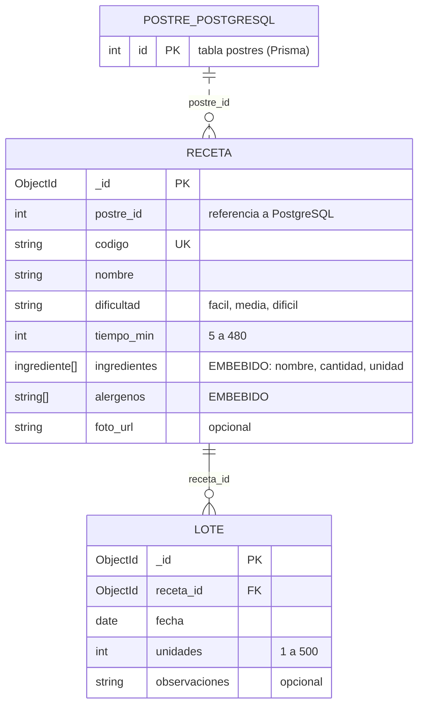

# Hito 2 · Workload y modelo documental

**Grupo:** G06  **Emprendimiento:** Dulce Hogar (repostería casera)  **Colección elegida (hito 1):** `recetas`

## 1. Workload

> Las frecuencias son estimadas para una repostería casera pequeña; ajústenlas si su grupo usó otras cifras.

| Actor | Operación | Lectura o escritura | Frecuencia (por día/hora) | Datos que usa |
|---|---|---|---|---|
| Dueña / repostero | Registrar una receta nueva | Escritura | ~5 por semana | código, nombre, dificultad, tiempo, ingredientes, alérgenos |
| Repostero | Consultar la receta completa al preparar un postre | Lectura | ~30 por día | receta con todos sus ingredientes |
| Repostero | Registrar el lote producido de una receta | Escritura | ~8 por día | recetaId, fecha, unidades, observaciones |
| Cliente (vía API) | Ver los alérgenos de un postre antes de pedirlo | Lectura | ~50 por día | postreId, alérgenos |
| Dueña | Revisar los lotes producidos por receta (reporte) | Lectura | ~1 por día | receta + sus lotes (`$lookup`) |

Lectura: 3 de 5 operaciones y la de mayor volumen (consultas diarias). La escritura más frecuente son los lotes, que se repiten todos los días: por eso se guardan aparte.

## 2. Relaciones: embeber o referenciar

| Relación | Cardinalidad | ¿Se lee junto? | ¿Cambia seguido? | ¿Crece sin límite? | Decisión |
|---|---|---|---|---|---|
| Receta → Ingredientes | 1:N | Sí, siempre con la receta | No (solo si se corrige la receta) | No (una receta tiene unas 5 a 20 líneas) | **Embebida** |
| Receta → Lotes de producción | 1:N | No, se consultan aparte (reporte) | Sí, cada día se agregan | **Sí**, crece con cada tanda | **Referenciada** (`recetaId`) |
| Receta → Postre (PostgreSQL) | N:1 | No (viven en bases distintas) | No | No | **Referenciada** (`postreId`, referencia lógica) |

## 3. ER de MongoDB

Lo embebido se dibuja DENTRO de la entidad (`campo[]`); lo referenciado, como caja aparte unida con una línea (`*_id`).

## 4. Playground (`grupo6.mongodb.js`)

- [x] `createCollection` con `$jsonSchema`: 1 `enum` (dificultad y unidad), 1 rango (`tiempoMin`: `minimum`/`maximum`) y 1 arreglo (`ingredientes` con `minItems`)
- [x] 2 inserts válidos y 2 rechazados (con el campo que falló)
- [x] `$lookup` entre `recetas` y `lotes` (+ `$unwind` en el sentido lote → receta)
